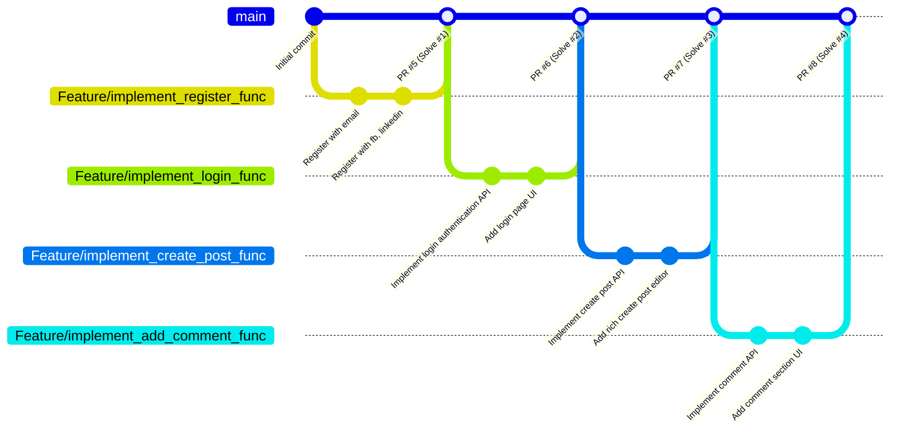

# 📚 StoryReader Blog - Hệ Thống Quản Lý & Đọc Truyện Trực Tuyến

[](https://nodejs.org/)
[](https://expressjs.com/)
[](https://tailwindcss.com/)
[-success?style=for-the-badge&logo=github&logoColor=white)](https://github.com/tuyenminhtran/blog-hethongquanlydoctruyen)

> **Báo cáo Bài Thực Hành Số 3: TRIỂN KHAI DỰ ÁN TRÊN GITHUB**  
> **Repository:** [https://github.com/tuyenminhtran/blog-hethongquanlydoctruyen.git](https://github.com/tuyenminhtran/blog-hethongquanlydoctruyen.git)  
> **Thời gian thực hiện Sprint 1:** 22/09/2014 – 26/09/2014 (1 tuần)  
> **Đội ngũ phát triển (Scrum Team):** David, Ruby (Đại diện Nhóm 7)

---

## 📑 Mục Lục
- [1. Giới Thiệu Dự Án](#1-giới-thiệu-dự-án)
- [2. Quản Lý Dự Án Theo Quy Trình Scrum Trên GitHub](#2-quản-lý-dự-án-theo-quy-trình-scrum-trên-github)
  - [2.1. Tạo Sprint với GitHub Milestone](#21-tạo-sprint-với-github-milestone)
  - [2.2. Xây Dựng Hệ Thống Label (Phân Loại Task, Trạng Thái, Thành Viên & Điểm Số)](#22-xây-dựng-hệ-thống-label)
  - [2.3. Tạo Task Dưới Dạng GitHub Issues](#23-tạo-task-dưới-dạng-github-issues)
  - [2.4. Liên Kết Task với Pull Request ("Solve #id")](#24-liên-kết-task-với-pull-request)
  - [2.5. Theo Dõi Tiến Độ & Tổng Kết Sprint](#25-theo-dõi-tiến-độ--tổng-kết-sprint)
- [3. Bảng Tổng Kết Sprint 1 Backlog](#3-bảng-tổng-kết-sprint-1-backlog)
- [4. Cấu Trúc Mã Nguồn](#4-cấu-trúc-mã-nguồn)
- [5. Hướng Dẫn Cài Đặt & Chạy Ứng Dụng](#5-hướng-dẫn-cài-đặt--chạy-ứng-dụng)
- [6. Danh Sách Tài Khoản Dùng Thử](#6-danh-sách-tài-khoản-dùng-thử)

---

## 1. Giới Thiệu Dự Án

**StoryReader Blog** là phân hệ blog và tương tác cộng đồng thuộc hệ thống quản lý & đọc truyện trực tuyến StoryReader. Nền tảng cho phép người dùng theo dõi các bài phân tích, review truyện chữ, truyện tranh nổi tiếng (Solo Leveling, Đấu Phá Thương Khung, Toàn Trí Độc Giả,...), đồng thời thảo luận và tương tác trực tiếp với các tác giả và biên tập viên.

Trong **Sprint 1**, dự án tập trung hoàn thiện 4 chức năng nền tảng:
1. **Đăng ký (Register):** Hỗ trợ đăng ký qua Email hoặc liên kết tài khoản mạng xã hội (Facebook, LinkedIn).
2. **Đăng nhập (Login):** Xác thực tài khoản qua email/username, bảo mật phiên, hỗ trợ Remember Me và social login.
3. **Đăng bài (Create Post):** Soạn thảo bài viết, phân loại thể loại (Manhwa, Tiên hiệp, Review...), đính kèm ảnh bìa và gắn thẻ tags.
4. **Bình luận (Add Comment):** Cho phép người đọc để lại ý kiến, phản hồi (reply), và tương tác thả tim (like comment).

---

## 2. Quản Lý Dự Án Theo Quy Trình Scrum Trên GitHub

### 2.1. Tạo Sprint với GitHub Milestone
GitHub Milestone được sử dụng làm đại diện cho **Sprint 1**:
- **Title:** `Sprint 1`
- **Due Date:** `September 26, 2014`
- **Description:**
  ```text
  Implement basic functions for blog:
  - Register.
  - Login.
  - Create post.
  - Add comment.
  ```
- **Trạng thái:** Hoàn thành **100%** (4/4 closed issues).

---

### 2.2. Xây Dựng Hệ Thống Label
Hệ thống Labels được thiết lập chuẩn theo mô hình Scrum nhằm định danh các thuộc tính của Task:

| Nhóm Label | Tên Label | Mã Màu (Hex) | Ý Nghĩa / Mục Đích Sử Dụng |
| :--- | :--- | :---: | :--- |
| **Story Points** | `0 point` | `#fef2c0` | Task có độ phức tạp bằng 0 (cấu hình, ghi chú) |
| | `1 point` | `#fef2c0` | Task rất đơn giản, thực hiện nhanh chóng |
| | `3 point` | `#fef2c0` | Task trung bình (ví dụ: Đăng nhập, Thêm comment) |
| | `7 point` | `#fef2c0` | Task lớn, nhiều luồng xử lý (ví dụ: Đăng ký, Đăng bài viết) |
| **Thành viên phụ trách** | `David` | `#d93f0b` | Task được giao cho thành viên David đảm nhiệm |
| | `Ruby` | `#d93f0b` | Task được giao cho thành viên Ruby đảm nhiệm |
| **Vòng đời Task** | `New` | `#fad8c7` | Task mới được tạo, nằm trong Sprint Backlog |
| | `In progress` | `#1d76db` | Task đang trong quá trình thực hiện |
| | `Done` | `#0e8a16` | Task đã được hoàn thành, kiểm thử và nghiệm thu |
| **Phân loại lỗi** | `bug` | `#d73a4a` | Vấn đề phát sinh hoặc lỗi chức năng cần sửa |
| | `wontfix` | `#ffffff` | Task hoặc lỗi được thống nhất không xử lý |

---

### 2.3. Tạo Task Dưới Dạng GitHub Issues
Mỗi chức năng trong Sprint được biểu diễn bằng 1 GitHub Issue chi tiết:

1. **Issue #1 - Implement register function**
   - **Mô tả:** `Allow user register by email or via facebook, linkedin.`
   - **Story Point:** `7 point`
   - **Phụ trách:** `Ruby`
   - **Milestone:** `Sprint 1`
   - **Link:** [#1](https://github.com/tuyenminhtran/blog-hethongquanlydoctruyen/issues/1)

2. **Issue #2 - Implement login function**
   - **Mô tả:** `Allow user login with email, username and password. Support authentication session and tokens.`
   - **Story Point:** `3 point`
   - **Phụ trách:** `David`
   - **Milestone:** `Sprint 1`
   - **Link:** [#2](https://github.com/tuyenminhtran/blog-hethongquanlydoctruyen/issues/2)

3. **Issue #3 - Implement create post function**
   - **Mô tả:** `Allow authors and users to create, draft, and publish new blog posts and novel chapters with rich text and images.`
   - **Story Point:** `7 point`
   - **Phụ trách:** `Ruby`
   - **Milestone:** `Sprint 1`
   - **Link:** [#3](https://github.com/tuyenminhtran/blog-hethongquanlydoctruyen/issues/3)

4. **Issue #4 - Implement add comment function**
   - **Mô tả:** `Allow readers to post comments, leave reviews and join discussions under blog posts and chapters.`
   - **Story Point:** `3 point`
   - **Phụ trách:** `David`
   - **Milestone:** `Sprint 1`
   - **Link:** [#4](https://github.com/tuyenminhtran/blog-hethongquanlydoctruyen/issues/4)

---

### 2.4. Liên Kết Task với Pull Request ("Solve #id")
Áp dụng cơ chế tham chiếu chéo (cross-reference) của GitHub để tự động liên kết Pull Request với Task thông qua cú pháp `Solve #id` trong phần mô tả của PR:



- **PR #5:** `Feature/implement register func` -> Mô tả: `Solve #1` -> [Xem PR #5](https://github.com/tuyenminhtran/blog-hethongquanlydoctruyen/pull/5)
- **PR #6:** `Feature/implement login func` -> Mô tả: `Solve #2` -> [Xem PR #6](https://github.com/tuyenminhtran/blog-hethongquanlydoctruyen/pull/6)
- **PR #7:** `Feature/implement create post func` -> Mô tả: `Solve #3` -> [Xem PR #7](https://github.com/tuyenminhtran/blog-hethongquanlydoctruyen/pull/7)
- **PR #8:** `Feature/implement add comment func` -> Mô tả: `Solve #4` -> [Xem PR #8](https://github.com/tuyenminhtran/blog-hethongquanlydoctruyen/pull/8)

---

### 2.5. Theo Dõi Tiến Độ & Tổng Kết Sprint
- Trong suốt Sprint, trạng thái task được luân chuyển: `New` -> `In progress` -> `Done`.
- Lọc tiến độ linh hoạt trên GitHub thông qua bộ lọc Labels (`is:issue milestone:"Sprint 1" label:David` hoặc `label:Ruby`).
- Cuối Sprint, Scrum Master tiến hành nghiệm thu, đóng toàn bộ các task và đánh dấu hoàn thành 100% mục tiêu Sprint 1.

---

## 3. Bảng Tổng Kết Sprint 1 Backlog

| Task ID | Tiêu Đề Nhiệm Vụ | Người Phụ Trách | Point | Branch Thực Hiện | Pull Request | Trạng Thái |
| :---: | :--- | :---: | :---: | :--- | :---: | :---: |
| **#1** | Implement register function | **Ruby** | 7 | `Feature/implement_register_func` | [PR #5](https://github.com/tuyenminhtran/blog-hethongquanlydoctruyen/pull/5) | `Done` (Closed) |
| **#2** | Implement login function | **David** | 3 | `Feature/implement_login_func` | [PR #6](https://github.com/tuyenminhtran/blog-hethongquanlydoctruyen/pull/6) | `Done` (Closed) |
| **#3** | Implement create post function | **Ruby** | 7 | `Feature/implement_create_post_func` | [PR #7](https://github.com/tuyenminhtran/blog-hethongquanlydoctruyen/pull/7) | `Done` (Closed) |
| **#4** | Implement add comment function | **David** | 3 | `Feature/implement_add_comment_func` | [PR #8](https://github.com/tuyenminhtran/blog-hethongquanlydoctruyen/pull/8) | `Done` (Closed) |
| **TỔNG** | **4 Chức Năng Cốt Lõi** | **David & Ruby** | **20 Points** | **4 Feature Branches** | **4 PRs Merged** | **100% Hoàn Thành** |

---

## 4. Cấu Trúc Mã Nguồn

```text
blog-hethongquanlydoctruyen/
├── public/                     # Giao diện người dùng (Client Web Application)
│   ├── css/
│   │   └── style.css           # Styling giao diện tùy biến (Dark mode / Glow / Cards)
│   ├── js/
│   │   └── app.js              # State quản lý Auth, Notifications, API Client
│   ├── index.html              # Trang chủ: Feed bài viết, bộ lọc thể loại & tìm kiếm
│   ├── register.html           # Giao diện Đăng ký (Email, Facebook, LinkedIn) [#1]
│   ├── login.html              # Giao diện Đăng nhập (Email, Username, Remember Me) [#2]
│   ├── create-post.html        # Giao diện Soạn thảo & Đăng bài viết / Đăng truyện [#3]
│   └── post-detail.html        # Giao diện Chi tiết bài viết & Khu vực bình luận [#4]
├── server.js                   # RESTful API Server (Node.js & Express)
├── package.json                # Cấu hình dự án và dependencies
└── README.md                   # Báo cáo tiến độ và hướng dẫn thực hành
```

---

## 5. Hướng Dẫn Cài Đặt & Chạy Ứng Dụng

### Yêu Cầu Môi Trường
- [Node.js](https://nodejs.org/) (phiên bản 18+ hoặc 20+)
- [Git](https://git-scm.com/)

### Các Bước Khởi Chạy
```bash
# 1. Clone repository về máy tính
git clone https://github.com/tuyenminhtran/blog-hethongquanlydoctruyen.git

# 2. Di chuyển vào thư mục dự án
cd blog-hethongquanlydoctruyen

# 3. Cài đặt các gói phụ thuộc
npm install

# 4. Khởi động Web Server
npm start
```

Sau khi khởi chạy thành công, truy cập trình duyệt tại địa chỉ:  
👉 **`http://localhost:3000`**

---

## 6. Danh Sách Tài Khoản Dùng Thử

Hệ thống cung cấp sẵn các tài khoản mẫu phục vụ cho việc chấm điểm và kiểm thử:

| Tài Khoản | Email | Mật Khẩu | Vai Trò | Chức Năng Đảm Nhận |
| :--- | :--- | :---: | :---: | :--- |
| **Ruby Nguyen** | `ruby@example.com` | `password123` | `Editor` | Đăng ký & Đăng bài viết (Post function) |
| **David Tran** | `david@example.com` | `password123` | `Reviewer` | Đăng nhập & Bình luận (Comment function) |
