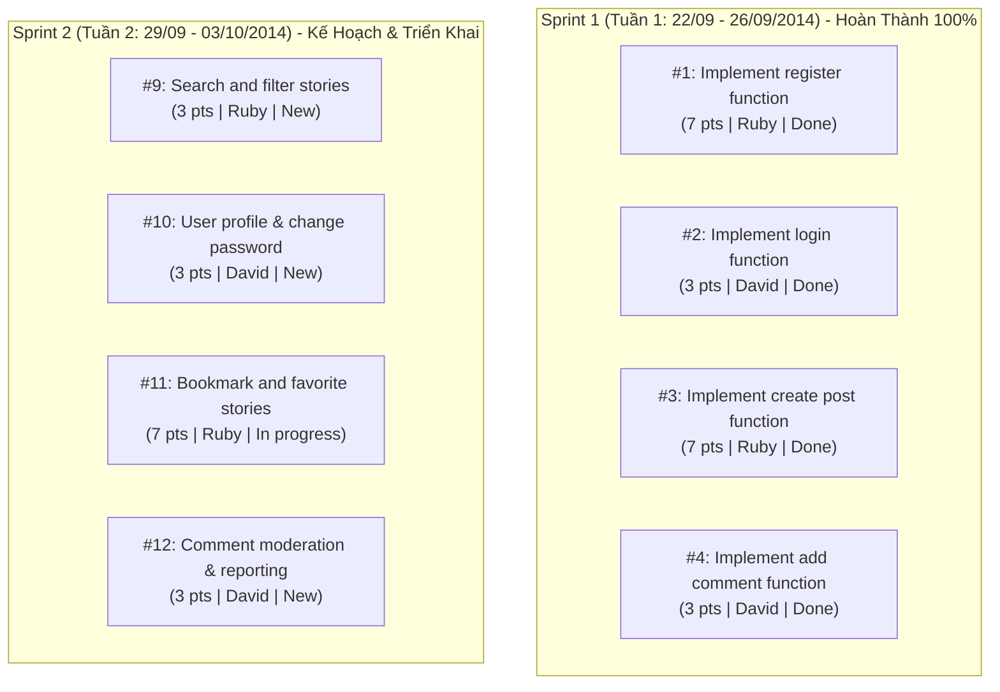

# 📚 StoryReader Blog - Hệ Thống Quản Lý & Đọc Truyện Trực Tuyến

[](https://nodejs.org/)
[](https://expressjs.com/)
[](https://tailwindcss.com/)
[](https://github.com/tuyenminhtran/blog-hethongquanlydoctruyen/milestones)

> **Báo cáo Bài Thực Hành Số 3: TRIỂN KHAI DỰ ÁN TRÊN GITHUB**  
> **Repository:** [https://github.com/tuyenminhtran/blog-hethongquanlydoctruyen.git](https://github.com/tuyenminhtran/blog-hethongquanlydoctruyen.git)  
> **Thời gian thực hiện toàn bài:** 2 tuần  
> - **Sprint 1 (Tuần 1: 22/09/2014 – 26/09/2014):** 4 chức năng cốt lõi (Hoàn thành 100%)  
> - **Sprint 2 (Tuần 2: 29/09/2014 – 03/10/2014):** 4 chức năng nâng cao (Kế hoạch Backlog & Đang triển khai)  
> **Đội ngũ phát triển (Scrum Team):** David, Ruby (Nhóm 7 - Trần Minh Tuyên)

---

## 📑 Mục Lục
- [1. Giới Thiệu Dự Án](#1-giới-thiệu-dự-án)
- [2. Quản Lý Dự Án Theo Quy Trình Scrum Trên GitHub (2 Milestones)](#2-quản-lý-dự-án-theo-quy-trình-scrum-trên-github-2-milestones)
  - [2.1. Quản Lý Sprint Bằng GitHub Milestones](#21-quản-lý-sprint-bằng-github-milestones)
  - [2.2. Xây Dựng Hệ Thống Label](#22-xây-dựng-hệ-thống-label)
  - [2.3. Tạo Task Dưới Dạng GitHub Issues](#23-tạo-task-dưới-dạng-github-issues)
  - [2.4. Liên Kết Task với Pull Request ("Solve #id")](#24-liên-kết-task-với-pull-request)
  - [2.5. Theo Dõi Tiến Độ & Tổng Kết Sprint](#25-theo-dõi-tiến-độ--tổng-kết-sprint)
- [3. Bảng Tổng Hợp Issues Theo Cả 2 Sprints](#3-bảng-tổng-hợp-issues-theo-cả-2-sprints)
- [4. Cấu Trúc Mã Nguồn](#4-cấu-trúc-mã-nguồn)
- [5. Hướng Dẫn Cài Đặt & Chạy Ứng Dụng](#5-hướng-dẫn-cài-đặt--chạy-ứng-dụng)
- [6. Danh Sách Tài Khoản Dùng Thử](#6-danh-sách-tài-khoản-dùng-thử)

---

## 1. Giới Thiệu Dự Án

**StoryReader Blog** là phân hệ blog và tương tác cộng đồng thuộc hệ thống quản lý & đọc truyện trực tuyến StoryReader. Nền tảng cho phép người dùng theo dõi các bài phân tích, review truyện chữ, truyện tranh nổi tiếng (Solo Leveling, Đấu Phá Thương Khung, Toàn Trí Độc Giả,...), đồng thời thảo luận và tương tác trực tiếp với các tác giả và biên tập viên.

Dự án được triển khai trong **2 tuần** với 2 Sprints rõ ràng:
- **Sprint 1 (Tuần 1):** Tích hợp 4 chức năng cơ bản: Đăng ký (Register), Đăng nhập (Login), Đăng bài (Create Post), Bình luận (Add Comment).
- **Sprint 2 (Tuần 2):** Mở rộng tính năng: Tìm kiếm & Lọc theo thể loại, Trang cá nhân & Đổi mật khẩu, Yêu thích truyện (Bookmark), và Kiểm duyệt bình luận.

---

## 2. Quản Lý Dự Án Theo Quy Trình Scrum Trên GitHub (2 Milestones)

### 2.1. Quản Lý Sprint Bằng GitHub Milestones
Kho lưu trữ được cấu hình đầy đủ **2 Milestones** tương ứng với 2 tuần thực hiện:

1. **[Milestone Sprint 1](https://github.com/tuyenminhtran/blog-hethongquanlydoctruyen/milestone/1)**
   - **Deadline:** `September 26, 2014`
   - **Mục tiêu:** Implement basic functions for blog: Register, Login, Create post, Add comment.
   - **Kết quả:** **100% complete** (4/4 closed issues).

2. **[Milestone Sprint 2](https://github.com/tuyenminhtran/blog-hethongquanlydoctruyen/milestone/2)**
   - **Deadline:** `October 03, 2014`
   - **Mục tiêu:** Implement advanced functions for blog (Week 2): Search & filter, User profile, Bookmarks, Comment moderation.
   - **Kết quả:** **Active Sprint** (4 tasks đang mở với Story Points & phân công cụ thể).

---

### 2.2. Xây Dựng Hệ Thống Label
Hệ thống Labels được thiết lập chuẩn theo mô hình Scrum nhằm định danh các thuộc tính của Task:

| Nhóm Label | Tên Label | Mã Màu (Hex) | Ý Nghĩa / Mục Đích Sử Dụng |
| :--- | :--- | :---: | :--- |
| **Story Points** | `0 point` | `#fef2c0` | Task cấu hình, tài liệu (0 điểm) |
| | `1 point` | `#fef2c0` | Task đơn giản, xử lý nhanh chóng |
| | `3 point` | `#fef2c0` | Task độ phức tạp trung bình |
| | `7 point` | `#fef2c0` | Task độ phức tạp lớn, nhiều xử lý |
| **Thành viên phụ trách** | `David` | `#d93f0b` | Task được giao cho thành viên David đảm nhiệm |
| | `Ruby` | `#d93f0b` | Task được giao cho thành viên Ruby đảm nhiệm |
| **Vòng đời Task** | `New` | `#fad8c7` | Task mới được tạo, nằm trong Sprint Backlog |
| | `In progress` | `#1d76db` | Task đang trong quá trình thực hiện |
| | `Done` | `#0e8a16` | Task đã được hoàn thành, kiểm thử và nghiệm thu |
| **Phân loại lỗi** | `bug` | `#d73a4a` | Vấn đề phát sinh hoặc lỗi chức năng cần sửa |
| | `wontfix` | `#ffffff` | Task hoặc lỗi được thống nhất không xử lý |

---

### 2.3. Tạo Task Dưới Dạng GitHub Issues
Mỗi chức năng được thể hiện bằng một GitHub Issue rõ ràng với đầy đủ Story Point, Assignee, Label và Milestone:



---

### 2.4. Liên Kết Task với Pull Request ("Solve #id")
Áp dụng cơ chế tham chiếu chéo (cross-reference) của GitHub để tự động liên kết Pull Request với Task thông qua cú pháp `Solve #id` trong phần mô tả của PR:

- **PR #5:** `Feature/implement register func` -> Mô tả: `Solve #1` -> [Xem PR #5](https://github.com/tuyenminhtran/blog-hethongquanlydoctruyen/pull/5)
- **PR #6:** `Feature/implement login func` -> Mô tả: `Solve #2` -> [Xem PR #6](https://github.com/tuyenminhtran/blog-hethongquanlydoctruyen/pull/6)
- **PR #7:** `Feature/implement create post func` -> Mô tả: `Solve #3` -> [Xem PR #7](https://github.com/tuyenminhtran/blog-hethongquanlydoctruyen/pull/7)
- **PR #8:** `Feature/implement add comment func` -> Mô tả: `Solve #4` -> [Xem PR #8](https://github.com/tuyenminhtran/blog-hethongquanlydoctruyen/pull/8)

---

## 3. Bảng Tổng Hợp Issues Theo Cả 2 Sprints

| Sprint | Mã Issue | Tên Nhiệm Vụ | Người Phụ Trách | Point | Trạng Thái | Pull Request Liên Kết |
| :---: | :---: | :--- | :---: | :---: | :---: | :---: |
| **Sprint 1** | **#1** | Implement register function | **Ruby** | 7 | `Done` (Closed) | [PR #5](https://github.com/tuyenminhtran/blog-hethongquanlydoctruyen/pull/5) (`Solve #1`) |
| **Sprint 1** | **#2** | Implement login function | **David** | 3 | `Done` (Closed) | [PR #6](https://github.com/tuyenminhtran/blog-hethongquanlydoctruyen/pull/6) (`Solve #2`) |
| **Sprint 1** | **#3** | Implement create post function | **Ruby** | 7 | `Done` (Closed) | [PR #7](https://github.com/tuyenminhtran/blog-hethongquanlydoctruyen/pull/7) (`Solve #3`) |
| **Sprint 1** | **#4** | Implement add comment function | **David** | 3 | `Done` (Closed) | [PR #8](https://github.com/tuyenminhtran/blog-hethongquanlydoctruyen/pull/8) (`Solve #4`) |
| **Sprint 2** | **#9** | Implement search and filter stories by category | **Ruby** | 3 | `New` (Open) | Tuần 2 |
| **Sprint 2** | **#10** | Implement user profile and change password | **David** | 3 | `New` (Open) | Tuần 2 |
| **Sprint 2** | **#11** | Implement bookmark and favorite stories | **Ruby** | 7 | `In progress` (Open) | Tuần 2 |
| **Sprint 2** | **#12** | Implement comment moderation and reporting | **David** | 3 | `New` (Open) | Tuần 2 |

---

## 4. Cấu Trúc Mã Nguồn

```text
blog-hethongquanlydoctruyen/
├── public/                     # Giao diện người dùng (Client Web Application)
│   ├── css/
│   │   └── style.css           # Styling giao diện tùy biến (Dark mode / Cards / Glassmorphism)
│   ├── js/
│   │   └── app.js              # State quản lý Auth, Notifications, API Client
│   ├── index.html              # Trang chủ: Feed bài viết, bộ lọc thể loại & tìm kiếm
│   ├── register.html           # Giao diện Đăng ký (Email, Facebook, LinkedIn) [#1]
│   ├── login.html              # Giao diện Đăng nhập (Email, Username, Remember Me) [#2]
│   ├── create-post.html        # Giao diện Soạn thảo & Đăng bài viết / Đăng truyện [#3]
│   └── post-detail.html        # Giao diện Chi tiết bài viết & Khu vực bình luận [#4]
├── server.js                   # RESTful API Server (Node.js & Express)
├── package.json                # Cấu hình dự án và dependencies
└── README.md                   # Báo cáo tiến độ và hướng dẫn thực hành
```

---

## 5. Hướng Dẫn Cài Đặt & Chạy Ứng Dụng

### Yêu Cầu Môi Trường
- [Node.js](https://nodejs.org/) (phiên bản 18+ hoặc 20+)
- [Git](https://git-scm.com/)

### Các Bước Khởi Chạy
```bash
# 1. Clone repository về máy tính
git clone https://github.com/tuyenminhtran/blog-hethongquanlydoctruyen.git

# 2. Di chuyển vào thư mục dự án
cd blog-hethongquanlydoctruyen

# 3. Cài đặt các gói phụ thuộc
npm install

# 4. Khởi động Web Server
npm start
```

Sau khi khởi chạy thành công, truy cập trình duyệt tại địa chỉ:  
👉 **`http://localhost:3000`**

---

## 6. Danh Sách Tài Khoản Dùng Thử

| Tài Khoản | Email | Mật Khẩu | Vai Trò | Chức Năng Đảm Nhận |
| :--- | :--- | :---: | :---: | :--- |
| **Ruby Nguyen** | `ruby@example.com` | `password123` | `Editor` | Đăng ký & Đăng bài viết (Post function) |
| **David Tran** | `david@example.com` | `password123` | `Reviewer` | Đăng nhập & Bình luận (Comment function) |
